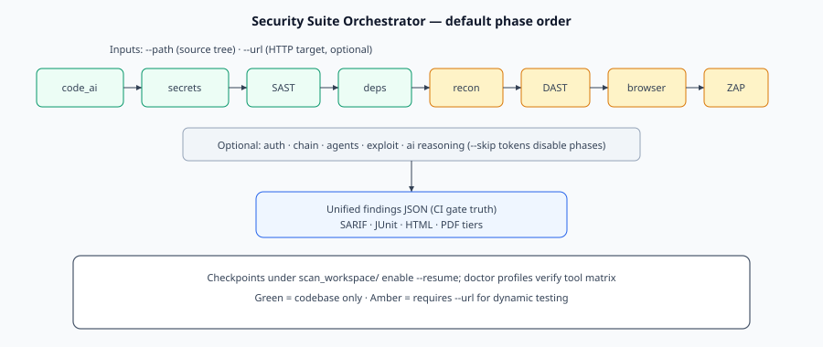

# Security Suite Orchestrator

## Business case

Product teams must ship with **merge-time security gates**, but enterprise ASPM platforms are expensive and many open-source scanners remain **one-off scripts** with incompatible outputs. Security reviews stall when HTML reports cannot drive CI, or when engineers cannot replay what ran before a release.

This orchestrator exists because **someone needs to own the workflow**: one CLI that chains SAST, secrets, dependencies, and optional DAST, then emits **JSON and SARIF that pipelines can trust**. It stays **local-first** so source code and findings remain under customer control, while still supporting staged URLs for dynamic testing. **Intent:** demonstrate a **productizable DevSecOps control plane** for SMEs and security-conscious builders—coordinates best-of-breed tools, does not replace formal pentest or compliance attestation ([OPERATING_GUARANTEES.md](OPERATING_GUARANTEES.md)).

**Stack:** Python 3.11+, pluggable CLI adapters (Semgrep, gitleaks, nuclei, Playwright, …)  
**License:** [MIT](LICENSE)  
**Topics:** `devsecops` · `sast` · `dast` · `sarif` · `security-automation`

> **Partners:** This repo demonstrates end-to-end **supply-chain and appsec orchestration** with reproducible run metadata, phase skipping, checkpoint/resume, and explicit CI gate semantics. Deep docs: [USER_MANUAL.md](USER_MANUAL.md), [CI_AND_GATES.md](CI_AND_GATES.md), [OPERATING_GUARANTEES.md](OPERATING_GUARANTEES.md).

---

## Overview

The Security Suite Orchestrator is a **workflow engine for security tools**, not a single scanner. You point it at a source tree (`--path`) and optionally a deployed URL (`--url`). It runs phases in a fixed order, merges normalized findings, and exports machine-readable outputs suitable for GitHub Advanced Security, Jenkins, or local pre-release checks.

**Design principles**

- **Local-first** — your code and reports stay on your machine unless you opt into network phases.
- **CI truth in JSON** — HTML is for humans; gates should read unified JSON + exit codes ([REPORT_TIERS.md](REPORT_TIERS.md)).
- **Composable** — skip tokens, presets (`--ci-profile`), and auth/chain configs tailor each run.
- **Auditable** — checkpoints, run manifests, redaction helpers ([AUDITABILITY.md](AUDITABILITY.md)).

---

## Scan phase workflow

<p align="center">
  
</p>

Green phases require only `--path`. Amber phases require `--url` (HTTP target). Optional branches (`auth`, `chain`, `agents`, `exploit`, `ai`) activate when configured.

---

## Quick start

```bash
git clone https://github.com/hfuenzalida/security-suite-orchestrator.git
cd security-suite-orchestrator
python -m venv .venv
source .venv/bin/activate   # Windows: .venv\Scripts\activate
pip install -e ".[dev]"
security-scan --version
security-scan --doctor
```

**Minimal static review (no URL):**

```bash
security-scan --path /path/to/repo --skip recon dast browser zap agents exploit
```

**With dynamic testing:**

```bash
security-scan --path . --url https://staging.example.com --fail-on high
```

---

## Installation modes

| Mode | Command |
|------|---------|
| Editable install | `pip install -e .` → CLI `security-scan` |
| No install | `python security_scan.py …` |
| Tool check | `security-scan doctor --profile ci-minimal` |

Optional extras: `pip install -e ".[full]"` for PDF and Playwright-heavy paths (see [pyproject.toml](pyproject.toml)).

---

## Core CLI concepts

| Flag / concept | Purpose |
|----------------|---------|
| `--path` | Root of source tree (SAST, secrets, deps) |
| `--url` | HTTP(S) target for recon, DAST, browser, ZAP |
| `--skip` | Space-separated phase tokens to disable |
| `--workspace` | Checkpoint directory (default `scan_workspace/`) |
| `--resume` | Continue a prior run id |
| `--fail-on` | CI severity threshold |
| `--auth-config` | Authenticated session JSON for protected targets |

See [USER_MANUAL.md](USER_MANUAL.md) §3–5 for the full phase table and skip tokens.

---

## Outputs

| Artifact | Audience |
|----------|----------|
| Unified findings JSON | Pipelines, policy gates |
| SARIF | GitHub/GitLab code scanning |
| JUnit | Test report ingestion |
| HTML / PDF | Engineers, audit packets |

**Do not commit** local `scan_workspace/`, `security_report.json`, or other generated scan artifacts—they may contain **redacted-but-detected secret patterns**. They are gitignored by design.

---

## Repository layout

| Path | Role |
|------|------|
| `security_scan.py` | CLI entry |
| `secscan/` | Phases, adapters, reporting, CI gates |
| `tests/` | Pytest coverage for CLI and hardening |
| `legal/` | Terms, privacy, commercial offering |
| `polymarket-lag-arb/` | Separate Rust research crate (optional) |

---

## Development

```bash
pip install -e ".[dev]"
pytest tests/ -q
```

Report vulnerabilities per [SECURITY.md](SECURITY.md).

---

## Related portfolio repositories

| Repository | Focus |
|------------|--------|
| [fhir-interop-hub](https://github.com/hfuenzalida/fhir-interop-hub) | Healthcare · FHIR |
| [rag-retail-analyst](https://github.com/hfuenzalida/rag-retail-analyst) | RAG · analytics |
| [ai-3-layer-coder](https://github.com/hfuenzalida/ai-3-layer-coder) | AI cost routing |
| [digital-brain](https://github.com/hfuenzalida/digital-brain) | Founder business OS |
| [ig-video-to-text](https://github.com/hfuenzalida/ig-video-to-text) | Local media ML |